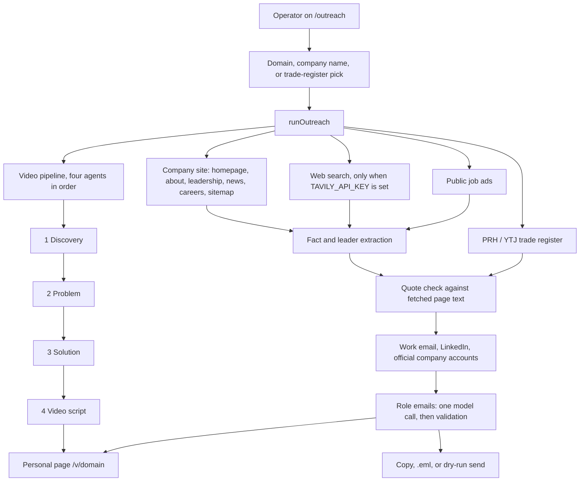

# Velho Outreach Engine

Velho Outreach Engine turns a company website into a sourced sales pitch. Give it a domain or a Finnish company name. It reads public pages, matches the legal entity, finds the operational bottleneck, writes a 45-second video, and drafts a separate email for each decision-maker. Every number in those emails points at a sentence that was actually on a page the app fetched.

The product has two screens. `/` is the original five-agent demo: one domain in, one video and one CEO email out. `/outreach` is the working tool: company search, verified research, one email per role, and a personal video page.

Built with Next.js 14 (App Router), React 18, TypeScript, and Tailwind. There is no database and no queue. One request runs the pipeline. If a model call misses its deadline, that step is replaced with labelled fallback content and the page still renders.

## Architecture



A run makes at most six model calls: Discovery, Problem, Solution, Video Script, one extraction call, and one email call. The fifth agent, the original CEO-only email writer, still serves `/`. The outreach flow does not call it.

Each model call is aborted at 6 seconds. Research sources run in parallel under their own shorter budgets. A timeout, a missing key, or a reply that fails validation becomes mock or template content, and the screen says so. The API answers 200 with a full payload rather than an error page.

## The five agents

All five live in `lib/agents.ts`. Each one has a JSON contract, a validator, and a deterministic fallback in `lib/mockData.ts`. The fallback is keyed by the domain, so the same company always gets the same stand-in profile. Every result is an `AgentEnvelope`: the data, plus whether it ran live, how long it took, and whether it timed out.

| Step | Agent | What it produces |
|---|---|---|
| 1 | Discovery | Company profile, brand colors, how the business operates |
| 2 | Problem | The bottleneck, the symptoms, and a quantified hour cost |
| 3 | Solution | A three-step fix mapped onto that bottleneck, and a headline metric |
| 4 | Video script | Four timed scenes and the cartoon beats |
| 5 | Email draft | The short CEO email used by the `/` demo |

Discovery reads a plain HTTP scrape of the homepage and a few high-signal paths. It does not launch a browser. Problem, Solution, and Video Script run one after another, because each one reads the previous step. On `/outreach` those four run beside the register lookup and the page fetch.

## From a name to a letter

`/outreach` is driven by `lib/outreach/orchestrator.ts`.

1. **Find the company.** A domain starts research immediately. A name searches the Finnish trade register (PRH / YTJ, CC BY 4.0) and shows matches with business ID, city, and status. The operator picks one. The match prefers a company whose registered website is that domain. A weak name-only match is never chosen automatically.

2. **Read public sources.** The company site, the register, and public job ads. Web search is optional and stays off without `TAVILY_API_KEY`. Personal social networks are not scraped. LinkedIn, Facebook, Instagram, and X results from search are dropped unless the operator asked for an unverified LinkedIn suggestion.

3. **Extract, then prove.** One model call proposes leaders, goals, hiring, and "why now" lines. A fact is kept only when its quote appears in the fetched text. Rejected quotes are counted. Register facts (age, line of business) are shown and do not count as substance. With no model key, keyword rules read the same pages and are labelled as such.

4. **Decide who gets an email.**

   | Evidence | What gets written |
   |---|---|
   | Two verified facts and a named CEO | One email per named leader. A missing COO or CFO is covered inside the CEO email. |
   | One verified fact | CEO email only, marked low confidence |
   | Nothing verified | No email. The research log shows what was searched |

5. **Write the letters.** One model call drafts every role. Each draft is checked against the fact set. A draft that invents a claim is replaced by a template, and the card says **Template fallback**. CEO, COO, and CFO share one estimate. The other roles open on the fact closest to their job: an IT hiring ad for the CTO, a sales ad for the sales lead.

6. **Attach a video.** Each email links to `/v/<domain>?r=<role>&t=<token>`. Opening that page counts a view for that role.

Work addresses come only from the company's own pages: a published address, or the company's published `firstname.lastname@` pattern when the mail domain has MX records. If nothing was published, a pattern can be guessed and is marked **guessed — unverified**. Personal inboxes are not looked up. Mail servers are never probed.

## The 45-second video

The timeline is fixed in `lib/cartoonPresets.ts`:

| Seconds | Beat |
|---|---|
| 0–6 | Intro, the company |
| 6–24 | The bottleneck |
| 24–38 | The fix |
| 38–45 | Book a meeting |

The picture is inline SVG, not stock footage. Four bottleneck categories (quoting, field reporting, scheduling, cross-system data) each have a hand-authored animation, so a timed-out script still shows a specific story. Narration sits in the voiceover and one lower-third caption. A Web Audio score ducks while the voice is speaking.

Voice order is ElevenLabs, then OpenAI, then the local Mac voice, then Edge, then Groq. Hosted voices have the same 6-second cap. If none return in time, the browser voice speaks the line. On Vercel only the hosted voices exist.

## Sending

Nothing is sent unless the operator clicks send. The default is a dry run: Gmail delivers to `OUTREACH_TEST_EMAIL`, and the subject is prefixed `[Dry run]`. A real recipient requires `OUTREACH_DRY_RUN=false` and `OUTREACH_ADMIN_SECRET`.

| Action | What it does |
|---|---|
| Copy | Plain text of the draft |
| Download .eml | An unsent draft that opens in a mail client |
| Open in Gmail | A compose window in the operator's browser |
| Send to my inbox | SMTP through `smtp.gmail.com` as `OUTREACH_SENDER_EMAIL`, using a Google app password |
| Unsubscribe | A confirm page. A GET never opts anyone out |

Gmail login uses `OUTREACH_SENDER_EMAIL` plus `GMAIL_APP_PASSWORD`. Both have to belong to the same Google account. Changing either value on Vercel does nothing until Production is redeployed. The sender name is baked into the draft at research time, so a new name shows up only on a letter written after that deploy.

Opt-outs are stored by address and by token. Results, views, and opt-outs live in memory and in a JSON file under the OS temp directory. A serverless host does not share that memory between instances.

## Layout

```
app/page.tsx                     demo dashboard
app/outreach/                    research, role emails, send
app/v/[domain]/                  personal video page
app/api/generate-outreach/       five-agent demo route
app/api/outreach/                research stream, send, .eml, views, unsubscribe
app/api/voiceover/               neural narration

lib/agents.ts                    the five agents
lib/llm.ts                       Groq, then OpenAI, 6s deadline
lib/tts.ts                       voice providers
lib/mockData.ts                  deterministic fallbacks
lib/cartoonPresets.ts            45s timeline and SVG beats

lib/outreach/orchestrator.ts     outreach run
lib/outreach/emails.ts           role letters
lib/outreach/senders.ts          Gmail and Resend
lib/outreach/research/           site, register, jobs, extraction, contacts
lib/outreach/pure/               quote check, roles, estimate, address pattern

types/pipeline.ts                agent contracts
types/outreach.ts                research and email contracts
docs/PROJECT.md                  demo dashboard, in detail
docs/OUTREACH.md                 outreach rules, in detail
```

## Run it

```bash
npm ci
cp .env.example .env.local
npm run dev
```

Open [http://localhost:3000/outreach](http://localhost:3000/outreach). With no keys, research still runs on the site and the trade register, and the letters are templates.

```bash
npm run typecheck
npm run lint
```

Voice on a Mac, without ElevenLabs:

```bash
npm run setup:voice
```

## Configuration

Put these in `.env.local` locally, or in the host's environment for a deploy. Server variables must not use the `NEXT_PUBLIC_` prefix. After changing them on Vercel, redeploy Production.

| Variable | Role |
|---|---|
| `GROQ_API_KEY` | Model for research, the video pipeline, and the letters. Used first. |
| `GROQ_MODEL` | Defaults to `openai/gpt-oss-120b`. A reasoning model can spend the 6s budget thinking and fall back. |
| `OPENAI_API_KEY` | Used when Groq is not set. Also the second voice. |
| `ELEVENLABS_API_KEY` | Narrator. Optional `ELEVENLABS_VOICE_ID`, `ELEVENLABS_MODEL`. |
| `TAVILY_API_KEY` | Extra pages and unverified LinkedIn suggestions. |
| `NEXT_PUBLIC_APP_URL` | Public origin for video and unsubscribe links. A localhost value is ignored on the deployed site. |
| `NEXT_PUBLIC_BOOKING_URL` | Calendar opened by the video's booking beat. |
| `OUTREACH_SENDER_NAME` | Signature. Unset, the letter says `[Sender name], Velho`. |
| `OUTREACH_SENDER_EMAIL` | Gmail account that sends. |
| `GMAIL_APP_PASSWORD` | App password for that same account. 2-Step Verification has to be on. |
| `OUTREACH_TEST_EMAIL` | Inbox that receives dry runs. |
| `OUTREACH_DRY_RUN` | `true` by default. Set `false` only to mail real recipients. |
| `OUTREACH_ADMIN_SECRET` | Required for a real send. |
| `ASSUMED_HOURLY_COST_EUR` | Hourly rate in the estimate. Default 40. Always labelled as an assumption. |
| `RESEND_API_KEY` | Sender used only when Gmail is not configured. |

## Data

Company identity and register lines come from the Finnish Patent and Registration Office (PRH) and YTJ open data, licensed under CC BY 4.0. The page shows that attribution. Quotes in the emails are taken from the company's own public site or from a public job ad, and each one keeps its source URL.
